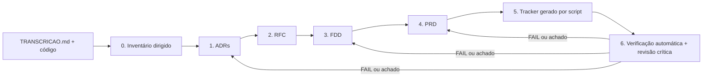

# Da Reunião ao Documento: Design Docs Gerados por IA

Pacote de design docs (PRD, RFC, FDD, ADRs e Tracker) do **Sistema de Webhooks de Notificação de Pedidos** de um Order Management System (Node.js + TypeScript + Prisma/MySQL), produzido com IA a partir da transcrição de uma reunião técnica (`TRANSCRICAO.md`) e do código do repositório.

> Enunciado original: [devfullcycle/mba-ia-desafio-design-docs-com-ia](https://github.com/devfullcycle/mba-ia-desafio-design-docs-com-ia). A entrega é só documental: `src/`, `prisma/`, `tests/` e as configurações não foram alterados.

## Sobre o desafio

Uma empresa que opera um OMS em produção decidiu, numa call de ~55 minutos entre tech lead, PM, dois engenheiros e uma engenheira de segurança, construir webhooks de saída para avisar três clientes B2B sobre mudanças de status de pedidos. Nada foi registrado além da transcrição. A tarefa foi transformar essa conversa, cruzada com o código existente, em documentação acionável o bastante para o time começar a implementar.

A dificuldade real não é escrever, e sim **filtrar e rastrear**: a reunião mistura decisões fechadas, alternativas descartadas, itens adiados, detalhes secundários e algumas ambiguidades. O pacote precisava registrar só o que tem origem identificável, colocar cada coisa na "altura" certa (produto, arquitetura, decisão pontual, implementação) e deixar explícito o que **não** entra.

## Ferramentas de IA utilizadas

| Ferramenta | Papel |
| --- | --- |
| **Claude Code (modelo Claude Opus 5.5)** | Agente principal: leu o código e a transcrição, gerou o inventário, os ADRs, o RFC, o FDD, o PRD e os scripts de verificação, e executou as rodadas de revisão. |
| **Busca semântica (RAG) sobre as aulas do MBA** | Recuperou os templates e as técnicas do módulo *Design Docs com IA* (seções de PRD de feature, estrutura de FDD, MADR, diferença RFC × ADR) para alinhar o formato ao ensinado no curso. |
| **Plugin `adrs-management` do professor** ([devfullcycle/claude-mkt-place](https://github.com/devfullcycle/claude-mkt-place)) | Referência de formato: as regras do agente `adr-generator` (MADR com 7 seções, no máximo 3 opções, sem código, marcar lacunas em vez de inventar) foram adaptadas no prompt de ADR. O plugin não foi executado, porque ele parte de *potential ADRs* extraídas de código, e aqui a fonte é uma reunião. |
| **Scripts Node escritos com a IA** (`processo/scripts/`) | `gerar-tracker.mjs` monta o tracker a partir dos IDs dos documentos; `verificar-entrega.mjs` checa os critérios de aceite e procura alucinações (timestamp/falante inexistente, arquivo inexistente, link quebrado). |

## Workflow adotado

Segui a ordem sugerida no enunciado, com uma etapa zero de inventário e verificação automática no fim:



1. **Contextualização.** A IA leu todo o código relevante (`order.service.ts`, `order.status.ts`, erros, middlewares, config, `server.ts`, `app.ts`, rotas, `schema.prisma`, `package.json`, testes) e a transcrição inteira. Em paralelo, consultou as aulas do curso para fixar os templates.
2. **Inventário dirigido** (`processo/inventario-transcricao.md`). Antes de qualquer documento, cada fala foi classificada em DEC/REQ/RNF/COD/DESC/ADI/ABERTO/CTX. Isso separou o que entra do que foi descartado ou adiado e gerou uma lista de **achados da leitura cruzada transcrição × código**, que depois virou premissas e questões em aberto.
3. **ADRs primeiro** (7 decisões), porque elas formam o esqueleto do "como".
4. **RFC** em cima dos ADRs, com as alternativas descartadas e as questões em aberto da reunião, sem descer ao detalhe de implementação.
5. **FDD** com o template como contrato de completude, consultando o código a cada contrato e integração.
6. **PRD** por último, como consolidação em linguagem de produto.
7. **Tracker** gerado por script a partir dos IDs que cada documento já declara com fonte. Item sem fonte faz o gerador reclamar.
8. **Verificação e revisão crítica:** script de verificação + leitura "advogado do diabo". Cada falha voltou para o documento de origem.

Para manter a interação com a IA reprodutível, cada etapa tem um prompt próprio em `processo/prompts/`, com entradas e saídas explícitas. A regra comum a todos é que **toda afirmação carrega a fonte** (`[hh:mm] Nome` ou caminho de arquivo); o que não tem fonte vira premissa numerada (`P-NN`, FDD §15) ou questão em aberto (`RFC-OQ-NN`).

## Prompts customizados

Os seis prompts completos estão em [`processo/prompts/`](processo/prompts/). Abaixo, os três mais relevantes.

**1. Inventário dirigido da transcrição** (a filtragem "o que entra e o que não entra"):

```text
Você é um analista técnico. Leia TRANSCRICAO.md inteira e classifique CADA fala
com conteúdo técnico ou de produto em exatamente uma categoria:

  DEC    decisão fechada (alguém declara "decidido", "anotado", "concordo" e ninguém contesta)
  REQ    requisito funcional explícito
  RNF    requisito não funcional / restrição (números: latência, tamanho, timeout...)
  COD    menção a arquivo, classe, função ou padrão do código existente
  DESC   alternativa descartada — registre o MOTIVO do descarte
  ADI    adiado / fora de escopo / "observar depois"
  ABERTO levantado e não decidido, OU decidido de forma ambígua
  CTX    contexto de negócio

Regras:
1. Uma linha por fala: | Timestamp | Falante | Categoria | Conteúdo |. Use o
   timestamp e o nome EXATOS da transcrição ("[09:17] Diego").
2. Não resuma decisões com palavras suas que mudem o sentido. Números sempre literais.
3. Algo descartado ou adiado NUNCA pode virar REQ. Se houver dúvida entre ADI e REQ, é ADI.
4. Procure ambiguidades numéricas (ex.: contagens que não batem com as somas ditas)
   e marque como ABERTO, explicando a ambiguidade.
5. Depois, confronte cada COD com o código real: o arquivo/classe/função existe?
   O comportamento citado bate com o código? Liste os conflitos numa seção
   "Achados da leitura cruzada transcrição × código".
6. Não proponha soluções nesta etapa. Só classifique.
```

**2. FDD com template como contrato de completude** (adaptado da aula "Prompt para FDD"):

```text
Escreva docs/FDD.md para que um desenvolvedor comece a codar sem perguntar nada.
Insumos: ADRs, RFC, inventário e o CÓDIGO (leia order.service.ts, order.status.ts,
shared/errors/*, middlewares/*, config/*, server.ts, app.ts, routes/index.ts,
prisma/schema.prisma, package.json, tests/setup.ts).

Esqueleto obrigatório: 1 Contexto · 2 Objetivos · 3 Escopo e exclusões · 4 Desenho
(componentes + modelo Prisma) · 5 Fluxos (outbox · worker · retry · DLQ/replay ·
rotação) · 6 Contratos (request, response, status codes; requisição de saída) ·
7 Configuração · 8 Matriz de erros WEBHOOK_* · 9 Resiliência · 10 Observabilidade
(logs, métricas, tracing) · 11 Integração com o sistema existente · 12 Dependências
· 13 Critérios de aceite · 14 Riscos · 15 Premissas

Regras:
- Todo item verificável fica numa linha de tabela com ID (FDD-FLUXO-07,
  FDD-ERR-03...) e uma coluna Fonte: [hh:mm] Nome ou caminho de arquivo.
- Qualquer escolha que a reunião não fez vira premissa P-NN na §15, com a fala ou
  arquivo de onde foi derivada. Nunca apresente premissa como decisão.
- Reuse o que existe: antes de propor uma classe/middleware, verifique se o código
  já tem algo equivalente e se o comportamento real dele atende (ex.: que código de
  erro o validate.middleware devolve de fato?).
- §11 cita apenas arquivos que existem; arquivos novos são marcados "(novo)".
- Nenhuma dependência nova: confira o package.json antes de citar biblioteca.
- Itens descartados na reunião não podem aparecer como requisito.
```

**3. Revisão crítica ("advogado do diabo")**:

```text
Revise o pacote (PRD, RFC, FDD, ADRs) como revisor cético. Para cada documento:
1. Liste toda afirmação sem fonte ([hh:mm] Nome ou arquivo). Para cada uma:
   achar a fonte, rebaixar a premissa, ou remover.
2. Procure contradições: entre documentos (mesmo número dito de dois jeitos),
   com a transcrição (algo descartado aparecendo como requisito) e com o código
   (arquivo/método citado que não existe ou não se comporta como descrito).
3. Procure duplicação de altura: detalhe de implementação no RFC/PRD, ou decisão
   sem ADR.
4. Procure promessas falsas (ex.: "no máximo X" quando há backlog ou retry).
Depois gere o tracker com processo/scripts/gerar-tracker.mjs e rode
processo/scripts/verificar-entrega.mjs; trate cada FAIL como bug do documento,
não do script — salvo prova em contrário.
```

## Iterações e ajustes

Foram **quatro ciclos principais**: (1) inventário e achados; (2) ADRs → RFC → FDD → PRD; (3) tracker gerado por script e verificação automática; (4) revisão crítica final. Os ajustes concretos abaixo saíram desses ciclos.

### 1. "5 tentativas" não fecha com os números ditos

Uma leitura direta da reunião registraria "5 tentativas, backoff 1m/5m/30m/2h/12h". O inventário marcou como **ABERTO**: são 5 intervalos que somam ~14,6h "entre primeira falha e última tentativa" ([09:17] Diego), o que só fecha com 1 envio inicial + 5 re-tentativas (6 envios). Em vez de escolher em silêncio, a interpretação virou a premissa **P-01** no FDD e a questão **RFC-OQ-08** para os revisores, e a tabela de backoff do FDD mostra o tempo acumulado de cada passo.

### 2. Recusar URL `http` "no schema Zod" não devolve `WEBHOOK_INVALID_URL`

A reunião pede as duas coisas: validação de `https` no schema Zod ([09:23] Sofia) e códigos `WEBHOOK_INVALID_URL` ([09:28] Bruno). Ao confrontar com o código, a IA verificou que `src/middlewares/validate.middleware.ts` converte qualquer `ZodError` em `VALIDATION_ERROR`. Um FDD "ingênuo" prometeria um código de erro que a stack não entrega. O FDD (§8) passou a documentar o comportamento real (código `WEBHOOK_*` em `details`) e a alternativa, caso os revisores prefiram o código no topo. Na mesma leitura apareceu que `NotFoundError` fixa `NOT_FOUND`, o que exige classes próprias para os 404 de webhook.

### 3. Limite de 64KB na inserção desfaria a mudança de status

A forma óbvia de aplicar "64KB, erro se ultrapassar" ([09:24] Larissa) é validar ao gravar o evento. Só que a gravação acontece dentro da transação de `changeStatus`; um erro ali faria rollback da mudança de status, exatamente o acoplamento que a reunião quis evitar ([09:04] Bruno). A checagem foi para o worker (evento vai direto para a DLQ, **P-06**). No mesmo raciocínio, o payload passou a ser guardado como `MEDIUMTEXT`, porque `TEXT` do MySQL tem teto de 65.535 bytes e um insert acima disso também quebraria a transação, e porque colunas `JSON` do MySQL reordenam chaves, o que mudaria o corpo assinado entre tentativas.

### 4. O tracker encontrou 16 itens sem fonte

A primeira execução do `gerar-tracker.mjs` reportou **16 itens do FDD sem fonte**: toda a matriz de erros da API e a tabela de logs tinham sido escritas sem coluna "Fonte". Era exatamente o sinal de alerta que o enunciado descreve. Cada linha recebeu sua origem (ou foi marcada como premissa derivada); depois disso, 0 itens sem fonte. Na mesma rodada, o gerador pegava a coluna errada nas questões em aberto do RFC (a "Proposta" em vez da "Fonte") e foi corrigido para ler a coluna pelo cabeçalho.

### 5. Revisão crítica final

A leitura "advogado do diabo" pegou três problemas que nenhum script pegaria:

- O PRD prometia "espera máxima de 2s até o evento ser lido", o que é falso com backlog ou retry. Foi reescrito como intervalo de leitura de 2s.
- O critério de aceite de rotação dependia de um mecanismo (duas assinaturas no header durante as 24h) que é premissa, não decisão. Agora ele cita a **P-08**.
- Caminho do endpoint de rotação, `202` no replay e prefixo `/admin` não foram ditos na reunião. Foram agrupados como premissa **P-20**, derivada das convenções do código.

Também saíram dessa revisão duas limitações que a reunião não discutiu e que agora estão no RFC como questões em aberto: **ordem sob retry** (um evento em backoff pode ser ultrapassado por um mais novo do mesmo pedido, RFC-OQ-05) e **`X-Timestamp` fora da assinatura** (HMAC só do corpo enfraquece a detecção de replay, RFC-OQ-06).

## Como navegar a entrega

Ordem sugerida de leitura:

| # | Arquivo | O que é |
| --- | --- | --- |
| 1 | [`docs/PRD.md`](docs/PRD.md) | Por que e o quê: problema, público, objetivos com metas, escopo e fora de escopo, requisitos, riscos |
| 2 | [`docs/RFC.md`](docs/RFC.md) | A proposta técnica para revisão: abordagem, alternativas descartadas, questões em aberto |
| 3 | [`docs/adrs/`](docs/adrs/README.md) | 7 ADRs (MADR), um por decisão, com índice e grafo de relações |
| 4 | [`docs/FDD.md`](docs/FDD.md) | Como construir: modelo de dados, fluxos, contratos, matriz de erros, resiliência, observabilidade, integração com o código, premissas |
| 5 | [`docs/TRACKER.md`](docs/TRACKER.md) | 261 itens → origem na transcrição (`[hh:mm] Nome`) ou no código |
| 6 | [`processo/`](processo/) | Evidências do processo: inventário da transcrição, prompts e scripts |

ADRs:

- [ADR-001 — Outbox transacional no MySQL](docs/adrs/ADR-001-outbox-transacional-no-mysql.md)
- [ADR-002 — Worker separado em polling](docs/adrs/ADR-002-worker-separado-em-polling.md)
- [ADR-003 — Retry com backoff exponencial e DLQ](docs/adrs/ADR-003-retry-com-backoff-exponencial-e-dlq.md)
- [ADR-004 — HMAC-SHA256 com secret por endpoint](docs/adrs/ADR-004-assinatura-hmac-sha256-com-secret-por-endpoint.md)
- [ADR-005 — At-least-once com `X-Event-Id`](docs/adrs/ADR-005-entrega-at-least-once-com-x-event-id.md)
- [ADR-006 — Reuso dos padrões existentes](docs/adrs/ADR-006-reuso-dos-padroes-existentes-do-projeto.md)
- [ADR-007 — Evento filtrado e renderizado na inserção](docs/adrs/ADR-007-evento-filtrado-e-renderizado-na-insercao.md)

Para reproduzir a verificação (Node ≥ 20, sem dependências):

```bash
node processo/scripts/gerar-tracker.mjs      # regenera docs/TRACKER.md a partir dos documentos
node processo/scripts/verificar-entrega.mjs  # critérios de aceite + checagens anti-alucinação
```
