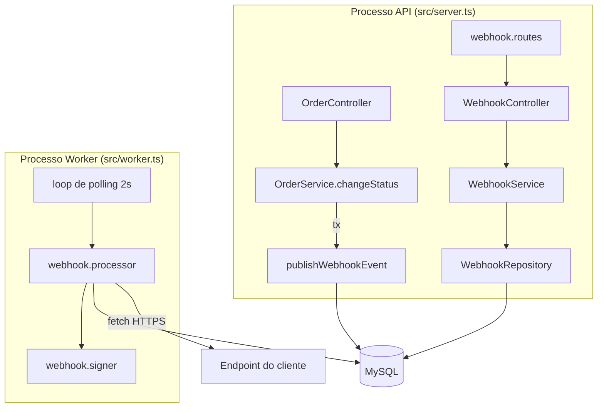

# FDD — Sistema de Webhooks de Notificação de Pedidos

| Campo | Valor |
| --- | --- |
| **Feature** | Webhooks de saída para mudança de status de pedido |
| **Autor** | Matheus Caldeira |
| **Status** | Pronto para revisão técnica |
| **Data** | 2026-11-09 |
| **Base** | [RFC](RFC.md) · [ADRs](adrs/README.md) · [PRD](PRD.md) · [Tracker](TRACKER.md) |

> **Convenção de rastreabilidade.** Cada item verificável tem um ID (`FDD-...`) e uma fonte entre colchetes: `[hh:mm] Nome` para a transcrição ou um caminho de arquivo para o código. O que não tem origem direta está marcado como **premissa `P-NN`** e listado na [§15](#15-premissas). As premissas precisam ser confirmadas pelos revisores.

---

## 1. Contexto e motivação técnica

Clientes B2B fazem polling em `GET /api/v1/orders` para descobrir mudanças de status ([09:00] Marcos). A feature substitui esse polling por notificações push com latência abaixo de 10s ([09:02] Marcos).

Pontos do código que condicionam o desenho:

- A mudança de status acontece em `OrderService.changeStatus` (`src/modules/orders/order.service.ts`), dentro de `prisma.$transaction`: lê o pedido, valida a transição com `canTransition` (`src/modules/orders/order.status.ts`), debita/repõe estoque, atualiza `orders` e cria `order_status_history`. É o ponto único em que um status muda depois da criação.
- O pedido nasce `PENDING` em `OrderService.create` (sem passar por `changeStatus`). As transições possíveis levam a `PAID`, `PROCESSING`, `SHIPPED`, `DELIVERED` e `CANCELLED`.
- Não há fila, evento, scheduler nem cliente HTTP de saída no projeto (`package.json`). O runtime é Node ≥ 20 (`engines`), que já traz `fetch`, `AbortSignal.timeout` e `crypto` nativos.
- Banco MySQL 8 via Prisma 5.22 (`prisma/schema.prisma`, `docker-compose.yml`); todos os IDs são UUID `CHAR(36)`.

## 2. Objetivos técnicos

| ID | Objetivo | Fonte |
| --- | --- | --- |
| FDD-OBJ-01 | Toda mudança de status que algum endpoint ativo do customer escuta gera exatamente um evento por endpoint, atomicamente com a mudança. | [09:06] Diego; [09:40] Bruno |
| FDD-OBJ-02 | Primeira tentativa de entrega em < 10s após o commit (polling de 2s + envio). | [09:02] Marcos; [09:09] Diego |
| FDD-OBJ-03 | Nenhuma latência ou indisponibilidade de cliente afeta `changeStatus`. | [09:04] Bruno |
| FDD-OBJ-04 | Indisponibilidades de cliente de até ~14,6h se recuperam sem intervenção. | [09:17] Diego |
| FDD-OBJ-05 | Toda requisição de saída é verificável pelo cliente (HMAC-SHA256) e deduplicável (`X-Event-Id`). | [09:22] Sofia; [09:25] Diego |
| FDD-OBJ-06 | Zero dependências novas; módulo no padrão dos existentes. | [09:29] Bruno; [09:30] Larissa |

## 3. Escopo e exclusões

**Dentro do escopo**

- Módulo `src/modules/webhooks` com CRUD de configuração, rotação de secret, histórico de entregas e replay de DLQ ([09:27] Bruno; [09:31]–[09:35]).
- Enfileiramento transacional em `changeStatus` ([09:40] Bruno).
- Worker `src/worker.ts` com polling, retry, DLQ e assinatura ([09:11] Larissa).
- Quatro tabelas novas e migração Prisma.

**Exclusões** (não implementar nesta fase)

| ID | Exclusão | Fonte |
| --- | --- | --- |
| FDD-EXC-01 | Webhooks de entrada (clientes enviando para o OMS). | [09:02] Marcos |
| FDD-EXC-02 | Email ao cliente em falhas repetidas. | [09:37] Larissa |
| FDD-EXC-03 | Rate limiting de saída (somente medir). | [09:39] Larissa |
| FDD-EXC-04 | Dashboard/painel visual. | [09:40] Larissa |
| FDD-EXC-05 | Arquivamento de eventos entregues. | [09:08] Diego |
| FDD-EXC-06 | Múltiplos workers / particionamento. | [09:13] Diego |
| FDD-EXC-07 | Itens do pedido no payload. | [09:43] Diego |
| FDD-EXC-08 | Evento de criação de pedido (o status inicial `PENDING` nasce em `create`, fora de `changeStatus`) — **P-04**. | `src/modules/orders/order.service.ts` |

## 4. Desenho da solução

### 4.1 Componentes



### 4.2 Modelo de dados (Prisma)

Novos modelos em `prisma/schema.prisma`, seguindo as convenções existentes (UUID `CHAR(36)`, `@@map` em snake_case, `createdAt`/`updatedAt`) ([09:51] Larissa).

```prisma
enum WebhookEventStatus {
  PENDING      // pendente
  PROCESSING   // processando
  DELIVERED    // entregue
  FAILED       // falhou (movido para a dead letter)
}

model Webhook {
  id                      String    @id @default(uuid()) @db.Char(36)
  customerId              String    @db.Char(36)
  url                     String    @db.VarChar(2048)
  secret                  String    @db.VarChar(128)
  previousSecret          String?   @db.VarChar(128)
  previousSecretExpiresAt DateTime?
  events                  Json      // array de OrderStatus, ex.: ["SHIPPED","DELIVERED"]
  active                  Boolean   @default(true)
  createdAt               DateTime  @default(now())
  updatedAt               DateTime  @updatedAt

  customer    Customer            @relation(fields: [customerId], references: [id], onDelete: Cascade)
  outbox      WebhookOutbox[]
  deliveries  WebhookDelivery[]
  deadLetters WebhookDeadLetter[]

  @@index([customerId, active])
  @@map("webhooks")
}

model WebhookOutbox {
  id            String             @id @db.Char(36) // = event_id / X-Event-Id, gerado na aplicação
  webhookId     String             @db.Char(36)
  orderId       String             @db.Char(36)     // sem FK: o snapshot sobrevive à exclusão do pedido
  eventType     String             @db.VarChar(64)  // "order.status_changed"
  payload       String             @db.MediumText   // JSON serializado (bytes estáveis entre tentativas)
  status        WebhookEventStatus @default(PENDING)
  attempts      Int                @default(0)      // envios HTTP já feitos
  nextAttemptAt DateTime           @default(now())
  lastError     String?            @db.VarChar(500)
  deliveredAt   DateTime?
  createdAt     DateTime           @default(now())
  updatedAt     DateTime           @updatedAt

  webhook    Webhook           @relation(fields: [webhookId], references: [id], onDelete: Cascade)
  deliveries WebhookDelivery[]

  @@index([status, createdAt])
  @@index([status, nextAttemptAt])
  @@index([orderId])
  @@map("webhook_outbox")
}

model WebhookDelivery {
  id            String   @id @default(uuid()) @db.Char(36)
  outboxId      String   @db.Char(36)
  webhookId     String   @db.Char(36)
  attemptNumber Int
  success       Boolean
  httpStatus    Int?
  responseBody  String?  @db.Text  // truncado (P-12)
  durationMs    Int
  errorCode     String?  @db.VarChar(64)
  createdAt     DateTime @default(now())

  outbox  WebhookOutbox @relation(fields: [outboxId], references: [id], onDelete: Cascade)
  webhook Webhook       @relation(fields: [webhookId], references: [id], onDelete: Cascade)

  @@index([webhookId, createdAt])
  @@map("webhook_deliveries")
}

model WebhookDeadLetter {
  id           String    @id @default(uuid()) @db.Char(36)
  outboxId     String    @unique @db.Char(36)
  webhookId    String    @db.Char(36)
  payload      String    @db.MediumText
  errorCode    String    @db.VarChar(64)
  reason       String    @db.VarChar(500)
  failedAt     DateTime  @default(now())
  replayedAt   DateTime?
  replayedById String?   @db.Char(36)

  webhook Webhook @relation(fields: [webhookId], references: [id], onDelete: Cascade)

  @@index([failedAt])
  @@map("webhook_dead_letter")
}
```

Notas de modelagem:

| ID | Nota | Fonte |
| --- | --- | --- |
| FDD-DADOS-01 | Configuração com url + secret + customer + estado ativo. | [09:21] Bruno |
| FDD-DADOS-02 | Índices por status e `created_at` na outbox. | [09:08] Diego |
| FDD-DADOS-03 | DLQ em tabela separada com payload, motivo e timestamp. | [09:18] Diego |
| FDD-DADOS-04 | `id` da outbox = `event_id`, UUID gerado na inserção (pacote `uuid` já usado em `src/middlewares/request-logger.middleware.ts`). | [09:25] Diego |
| FDD-DADOS-05 | `payload` como texto serializado, e não coluna `JSON`: o MySQL normaliza a ordem das chaves de colunas `JSON`; texto garante corpo idêntico em todas as tentativas. `MEDIUMTEXT` porque `TEXT` tem teto de 65.535 bytes, e um insert acima disso falharia dentro da transação de status. | `prisma/schema.prisma` (provider `mysql`) — premissa **P-13** |
| FDD-DADOS-06 | `orderId` sem FK: `OrderService.delete` permite apagar pedidos `CANCELLED`, e o evento de cancelamento ainda pendente precisa sobreviver. | `src/modules/orders/order.service.ts` |

## 5. Fluxos detalhados

### 5.1 Fluxo 1 — Criação do evento na outbox (API)

```mermaid
sequenceDiagram
  participant C as OrderController
  participant S as OrderService.changeStatus
  participant P as publishWebhookEvent
  participant DB as MySQL (tx)
  C->>S: PATCH /orders/:id/status
  S->>DB: BEGIN; SELECT order (+items)
  S->>S: canTransition(from,to); débito/reposição de estoque
  S->>DB: UPDATE orders; INSERT order_status_history
  S->>P: publishWebhookEvent(tx, order, from, to)
  P->>DB: SELECT webhooks ativos do customer
  P->>P: filtra por events ∋ to; renderiza payload
  P->>DB: INSERT webhook_outbox (1 linha por endpoint)
  S->>DB: SELECT refreshed; COMMIT
  Note over S,DB: Qualquer erro em P → throw → ROLLBACK de tudo
```

| Passo | ID | Regra | Fonte |
| --- | --- | --- | --- |
| 1 | FDD-FLUXO-01 | `changeStatus` chama `publishWebhookEvent(tx, order, from, to)` depois de `orderStatusHistory.create`, dentro do mesmo `$transaction`. | [09:41] Bruno |
| 2 | FDD-FLUXO-02 | Busca `webhooks` com `customerId = order.customerId` e `active = true`. | [09:21] Bruno |
| 3 | FDD-FLUXO-03 | Mantém só os endpoints cujo `events` contém `to`. Se nenhum sobrar, retorna sem inserir. | [09:34] Bruno |
| 4 | FDD-FLUXO-04 | Para cada endpoint: gera `eventId` (UUID v4), renderiza o payload (§6.9) e insere `webhook_outbox` com `status=PENDING`, `attempts=0`, `nextAttemptAt=now()`. Um evento por endpoint, cada um com seu `event_id` (**P-02**). | [09:25] Diego; [09:52] Larissa |
| 5 | FDD-FLUXO-05 | Erro em qualquer passo é relançado como `WebhookEnqueueError` (`WEBHOOK_ENQUEUE_FAILED`, 500), o que aborta a transação: o status não muda. | [09:40] Bruno; [09:41] Diego |
| 6 | FDD-FLUXO-06 | O tamanho do payload **não** é validado aqui (ver Fluxo 2, passo 4). | **P-06** |

### 5.2 Fluxo 2 — Processamento pelo worker

```mermaid
sequenceDiagram
  participant L as Loop (2s)
  participant DB as MySQL
  participant W as processor
  participant CL as Cliente
  L->>DB: SELECT PENDING com nextAttemptAt<=now ORDER BY createdAt LIMIT N
  loop para cada evento, em ordem
    W->>DB: UPDATE status=PROCESSING WHERE id=? AND status=PENDING
    W->>DB: SELECT webhook
    W->>W: checa ativo, secret, tamanho ≤ 64KB
    W->>CL: POST url (headers + assinatura), timeout 10s
    alt 2xx
      W->>DB: tx: INSERT delivery(success); UPDATE DELIVERED, deliveredAt
    else falha
      W->>DB: tx: INSERT delivery(falha); retry (5.3) ou DLQ (5.4)
    end
  end
  L->>L: aguarda 2s após o fim do ciclo
```

| Passo | ID | Regra | Fonte |
| --- | --- | --- | --- |
| 0 | FDD-FLUXO-07 | Na inicialização, o worker devolve para `PENDING` eventos presos em `PROCESSING` (queda no meio de um envio). É seguro porque a entrega é at-least-once e há uma única instância (**P-07**). | [09:24] Diego |
| 1 | FDD-FLUXO-08 | A cada ciclo, lê até `WEBHOOK_WORKER_BATCH_SIZE` (padrão 10, **P-14**) eventos `PENDING` com `nextAttemptAt <= now()`, ordenados por `createdAt` ASC. | [09:08] Diego; [09:09] Diego |
| 2 | FDD-FLUXO-09 | Processa o lote **sequencialmente**, na ordem lida, o que preserva a ordem por pedido com uma só instância (**P-16**). | [09:12] Diego |
| 3 | FDD-FLUXO-10 | Marca `PROCESSING` com update condicional (`WHERE status='PENDING'`). | [09:08] Diego |
| 4 | FDD-FLUXO-11 | Pré-checagens, em ordem: endpoint inexistente → descarta (removido por cascade); `active=false` → DLQ `WEBHOOK_DISABLED` (**P-17**); sem secret → DLQ `WEBHOOK_SECRET_REQUIRED`; corpo > 65.536 bytes → DLQ `WEBHOOK_PAYLOAD_TOO_LARGE`, sem envio e sem retry (**P-06**). | [09:24] Larissa; [09:28] Bruno |
| 5 | FDD-FLUXO-12 | Monta headers e assinatura (§6.9) e faz `fetch(url, { method: 'POST', body, redirect: 'manual', signal: AbortSignal.timeout(10_000) })`. | [09:42] Diego; [09:44] Diego |
| 6 | FDD-FLUXO-13 | Sucesso = status HTTP 2xx. Qualquer outra resposta (incluindo 3xx), timeout ou erro de rede = falha (**P-05**). | [09:42] Diego |
| 7 | FDD-FLUXO-14 | Registra uma linha em `webhook_deliveries` por tentativa (status HTTP, corpo truncado, `durationMs`, `errorCode`), na mesma transação que atualiza o evento. | [09:34] Marcos |
| 8 | FDD-FLUXO-15 | Sucesso → `DELIVERED`, `deliveredAt=now()`, `attempts+1`. | [09:08] Diego |
| 9 | FDD-FLUXO-16 | O próximo ciclo começa 2s **após o fim** do anterior (`setTimeout` encadeado, sem sobreposição de ciclos). | [09:09] Diego |

### 5.3 Fluxo 3 — Retry com backoff

Interpretação adotada (**P-01**, questão RFC-OQ-08): 1 envio inicial + 5 re-tentativas.

| Envio nº (`attempts` após o envio) | Se falhar, próximo envio em | Tempo acumulado desde a 1ª falha |
| --- | --- | --- |
| 1 (inicial) | +1 min | 1 min |
| 2 | +5 min | 6 min |
| 3 | +30 min | 36 min |
| 4 | +2 h | 2 h 36 min |
| 5 | +12 h | 14 h 36 min |
| 6 | — → DLQ (`WEBHOOK_MAX_ATTEMPTS_EXCEEDED`) | — |

| ID | Regra | Fonte |
| --- | --- | --- |
| FDD-FLUXO-17 | `RETRY_SCHEDULE_MS = [60_000, 300_000, 1_800_000, 7_200_000, 43_200_000]` é constante de código (decisão de arquitetura, não configuração). | [09:17] Larissa |
| FDD-FLUXO-18 | Em falha com `attempts <= 5`: `status=PENDING`, `nextAttemptAt = now + RETRY_SCHEDULE_MS[attempts-1]`, `lastError` preenchido. | [09:15] Diego |
| FDD-FLUXO-19 | O `event_id` e o corpo serializado não mudam entre tentativas. | [09:25] Diego |
| FDD-FLUXO-20 | Limitação: um evento em backoff pode ser ultrapassado por um evento posterior do mesmo pedido (RFC-OQ-05). | [09:13] Larissa |

### 5.4 Fluxo 4 — Dead letter e replay manual

| ID | Regra | Fonte |
| --- | --- | --- |
| FDD-FLUXO-21 | Falha permanente: em uma transação, `webhook_outbox.status=FAILED` e insere `webhook_dead_letter` (`outboxId`, `webhookId`, `payload`, `errorCode`, `reason`, `failedAt`). | [09:18] Diego |
| FDD-FLUXO-22 | Replay: `POST /api/v1/admin/webhooks/dead-letter/:id/replay`, só ADMIN (`requireRole('ADMIN')`). | [09:18] Diego; [09:36] Larissa |
| FDD-FLUXO-23 | Em uma transação: devolve o evento original para `PENDING`, `attempts=0`, `nextAttemptAt=now()`, **mantendo o `event_id`**; marca a dead letter com `replayedAt` e `replayedById` (**P-11**). | [09:18] Diego |
| FDD-FLUXO-24 | Loga `webhook_dead_letter_replayed` com `userId`, `requestId`, `deadLetterId`, `eventId`, para auditoria. | [09:36] Sofia |
| FDD-FLUXO-25 | Dead letter já reprocessada → 409 `WEBHOOK_ALREADY_REPLAYED`. Se o evento reprocessado esgotar as tentativas de novo, o registro de dead letter do mesmo `outboxId` (`@unique`) é **atualizado** (upsert: novo `errorCode`, `reason`, `failedAt`; `replayedAt`/`replayedById` zerados). O histórico completo de tentativas fica em `webhook_deliveries` (**P-11**). | [09:18] Diego |

### 5.5 Fluxo 5 — Rotação de secret

| ID | Regra | Fonte |
| --- | --- | --- |
| FDD-FLUXO-26 | `POST /api/v1/webhooks/:id/secret/rotate` gera nova secret, move a atual para `previousSecret` e define `previousSecretExpiresAt = now + 24h`. | [09:21] Sofia |
| FDD-FLUXO-27 | Enquanto `previousSecretExpiresAt > now`, o worker envia `X-Signature` com duas assinaturas: a da secret nova e a da anterior (**P-08**). Depois disso, só a nova. | [09:21] Sofia |
| FDD-FLUXO-28 | Uma nova rotação durante o grace period descarta a anterior imediatamente (só existem duas secrets por vez) (**P-08**). | [09:21] Sofia |

## 6. Contratos públicos

### 6.1 Convenções

- Prefixo `/api/v1` (`src/app.ts`); autenticação `Authorization: Bearer <JWT>` (`authenticate` em `src/middlewares/auth.middleware.ts`).
- Corpo de erro do `errorMiddleware` (`src/middlewares/error.middleware.ts`): `{ "error": { "code", "message", "details?" } }`.
- JSON da API em camelCase, como nos módulos existentes. O payload enviado ao cliente usa snake_case, conforme definido na reunião ([09:43] Diego).
- Listagens paginadas usam `paginated()` de `src/shared/http/response.ts`.
- `customerId` vai no body (cadastro) e na query string (listagem), não no JWT ([09:32] Larissa, **P-03**). Rotas fora de `/admin` aceitam qualquer role autenticada ([09:37] Sofia).

### 6.2 FDD-CONTRATO-01 — Cadastrar endpoint

`POST /api/v1/webhooks` — fonte: [09:31] Marcos

Request:

```http
POST /api/v1/webhooks
Authorization: Bearer eyJhbGciOi...
Content-Type: application/json

{
  "customerId": "7d0f4a52-3c1e-4c39-9a4e-2b8f0c6d1e11",
  "url": "https://hooks.atlas.example/oms",
  "events": ["SHIPPED", "DELIVERED"]
}
```

Response `201 Created` (a secret só aparece aqui e na rotação, **P-10**):

```json
{
  "id": "b3c1e2d4-5f60-4a7b-8c9d-0e1f2a3b4c5d",
  "customerId": "7d0f4a52-3c1e-4c39-9a4e-2b8f0c6d1e11",
  "url": "https://hooks.atlas.example/oms",
  "events": ["SHIPPED", "DELIVERED"],
  "active": true,
  "secret": "9f2c5e0b7a1d4c8e6b3f2a1d0c9e8b7a6f5e4d3c2b1a09f8e7d6c5b4a3f2e1d0",
  "createdAt": "2026-11-09T12:00:00.000Z",
  "updatedAt": "2026-11-09T12:00:00.000Z"
}
```

Validação (`createWebhookSchema` em `webhook.schemas.ts`):

| Campo | Regra | Fonte |
| --- | --- | --- |
| `customerId` | UUID; customer precisa existir (senão 404 `WEBHOOK_CUSTOMER_NOT_FOUND`) | [09:32] Larissa |
| `url` | URL válida, protocolo `https:` obrigatório, até 2048 chars | [09:23] Sofia |
| `events` | Array não vazio, sem repetição, de `PAID`, `PROCESSING`, `SHIPPED`, `DELIVERED`, `CANCELLED` (**P-04**) | [09:33] Marcos; `src/modules/orders/order.status.ts` |
| `secret` | Não aceito no body; gerado pela plataforma (`crypto.randomBytes(32)` em hex) | [09:31] Marcos |

Status: `201`, `400 VALIDATION_ERROR` (com `details` `WEBHOOK_INVALID_URL`/`WEBHOOK_INVALID_EVENTS`, ver §8), `401 UNAUTHORIZED`, `404 WEBHOOK_CUSTOMER_NOT_FOUND`.

### 6.3 FDD-CONTRATO-02 — Listar endpoints de um customer

`GET /api/v1/webhooks?customerId=<uuid>&page=1&pageSize=20` — fonte: [09:33] Bruno

Response `200 OK` (sem `secret`):

```json
{
  "data": [
    {
      "id": "b3c1e2d4-5f60-4a7b-8c9d-0e1f2a3b4c5d",
      "customerId": "7d0f4a52-3c1e-4c39-9a4e-2b8f0c6d1e11",
      "url": "https://hooks.atlas.example/oms",
      "events": ["SHIPPED", "DELIVERED"],
      "active": true,
      "secretRotationGraceUntil": null,
      "createdAt": "2026-11-09T12:00:00.000Z",
      "updatedAt": "2026-11-09T12:00:00.000Z"
    }
  ],
  "pagination": { "page": 1, "pageSize": 20, "total": 1, "totalPages": 1 }
}
```

Status: `200`, `400 VALIDATION_ERROR` (`customerId` ausente ou inválido), `401`, `404 WEBHOOK_CUSTOMER_NOT_FOUND`.

### 6.4 FDD-CONTRATO-03 — Editar endpoint

`PATCH /api/v1/webhooks/:id` — fonte: [09:33] Bruno

```http
PATCH /api/v1/webhooks/b3c1e2d4-5f60-4a7b-8c9d-0e1f2a3b4c5d
Authorization: Bearer eyJhbGciOi...
Content-Type: application/json

{ "events": ["PAID", "SHIPPED", "DELIVERED"], "active": true }
```

Response `200 OK`: mesmo formato do item de listagem, já atualizado. Campos editáveis: `url`, `events`, `active` (**P-19**); `customerId` e `secret` não são editáveis. A mudança vale para eventos **futuros**; eventos já na outbox não são refiltrados ([ADR-007](adrs/ADR-007-evento-filtrado-e-renderizado-na-insercao.md)).

Status: `200`, `400 VALIDATION_ERROR`, `401`, `404 WEBHOOK_NOT_FOUND`.

### 6.5 FDD-CONTRATO-04 — Remover endpoint

`DELETE /api/v1/webhooks/:id` — fonte: [09:33] Bruno

Response `204 No Content`, sem corpo. A remoção apaga em cascata eventos pendentes, histórico e dead letters do endpoint (**P-13**); para apenas pausar, use `PATCH { "active": false }`.

Status: `204`, `401`, `404 WEBHOOK_NOT_FOUND`.

### 6.6 FDD-CONTRATO-05 — Rotacionar secret

`POST /api/v1/webhooks/:id/secret/rotate` — fonte: [09:21] Sofia (caminho: **P-20**)

Request sem corpo. Response `200 OK`:

```json
{
  "id": "b3c1e2d4-5f60-4a7b-8c9d-0e1f2a3b4c5d",
  "secret": "4e1a7c9b2d3f5e6a8b0c1d2e3f4a5b6c7d8e9f0a1b2c3d4e5f6a7b8c9d0e1f2a",
  "previousSecretExpiresAt": "2026-11-10T12:00:00.000Z"
}
```

Status: `200`, `401`, `404 WEBHOOK_NOT_FOUND`.

### 6.7 FDD-CONTRATO-06 — Histórico de entregas

`GET /api/v1/webhooks/:id/deliveries` — fonte: [09:34] Marcos

Request sem corpo. Response `200 OK` com as **100 tentativas mais recentes** (ordem decrescente de `createdAt`) e o payload do evento:

```json
{
  "data": [
    {
      "id": "0c7b2f44-9a1e-4d3b-8f6a-5e2d1c0b9a87",
      "eventId": "5b1d8e6c-2f4a-4c7e-9b3d-1a0f8e7d6c5b",
      "eventType": "order.status_changed",
      "attemptNumber": 1,
      "success": true,
      "httpStatus": 200,
      "durationMs": 182,
      "errorCode": null,
      "responseBody": "{\"received\":true}",
      "payload": {
        "event_id": "5b1d8e6c-2f4a-4c7e-9b3d-1a0f8e7d6c5b",
        "event_type": "order.status_changed",
        "timestamp": "2026-11-09T12:05:00.000Z",
        "order_id": "e2a9c3f1-7b4d-4e8a-9c1f-3d5b7a9e1c2f",
        "order_number": "ORD-000042",
        "from_status": "PROCESSING",
        "to_status": "SHIPPED",
        "customer_id": "7d0f4a52-3c1e-4c39-9a4e-2b8f0c6d1e11",
        "total_cents": 15900
      },
      "createdAt": "2026-11-09T12:05:01.734Z"
    }
  ]
}
```

Status: `200`, `401`, `404 WEBHOOK_NOT_FOUND`.

### 6.8 FDD-CONTRATO-07 — Replay de dead letter (admin)

`POST /api/v1/admin/webhooks/dead-letter/:id/replay` — fonte: [09:18] Diego; [09:36] Sofia

```http
POST /api/v1/admin/webhooks/dead-letter/a8d2e4f6-1b3c-4d5e-8f7a-9b0c1d2e3f4a/replay
Authorization: Bearer <JWT com role ADMIN>
```

Response `202 Accepted` (o evento volta para a fila; a entrega acontece no worker):

```json
{
  "deadLetterId": "a8d2e4f6-1b3c-4d5e-8f7a-9b0c1d2e3f4a",
  "eventId": "5b1d8e6c-2f4a-4c7e-9b3d-1a0f8e7d6c5b",
  "status": "PENDING",
  "replayedAt": "2026-11-10T09:30:00.000Z",
  "replayedById": "c4f1e2d3-a5b6-4c7d-8e9f-0a1b2c3d4e5f"
}
```

Status: `202`, `401 UNAUTHORIZED`, `403 FORBIDDEN` (role ≠ ADMIN, via `requireRole`), `404 WEBHOOK_DEAD_LETTER_NOT_FOUND`, `409 WEBHOOK_ALREADY_REPLAYED`.

### 6.9 Requisição de saída ao cliente

FDD-CONTRATO-08 — o webhook propriamente dito, enviado pelo worker.

```http
POST https://hooks.atlas.example/oms
Content-Type: application/json
X-Event-Id: 5b1d8e6c-2f4a-4c7e-9b3d-1a0f8e7d6c5b
X-Webhook-Id: b3c1e2d4-5f60-4a7b-8c9d-0e1f2a3b4c5d
X-Timestamp: 2026-11-09T12:05:01.552Z
X-Signature: sha256=3f6c1b9e0a7d...e21

{"event_id":"5b1d8e6c-2f4a-4c7e-9b3d-1a0f8e7d6c5b","event_type":"order.status_changed","timestamp":"2026-11-09T12:05:00.000Z","order_id":"e2a9c3f1-7b4d-4e8a-9c1f-3d5b7a9e1c2f","order_number":"ORD-000042","from_status":"PROCESSING","to_status":"SHIPPED","customer_id":"7d0f4a52-3c1e-4c39-9a4e-2b8f0c6d1e11","total_cents":15900}
```

| Elemento | Especificação | Fonte |
| --- | --- | --- |
| `event_id` | UUID gerado na inserção; igual ao `X-Event-Id` | [09:25] Diego |
| `event_type` | Sempre `order.status_changed` nesta fase | [09:43] Diego |
| `timestamp` | ISO 8601 UTC do momento da mudança de status (renderização), **P-15** | [09:43] Diego |
| `order_id`, `order_number`, `customer_id` | Do pedido (`Order.id`, `Order.orderNumber`, `Order.customerId`) | [09:43] Diego; `prisma/schema.prisma` |
| `from_status`, `to_status` | Transição que gerou o evento | [09:43] Diego |
| `total_cents` | `Order.totalCents`; único "campo básico" incluído, sem itens | [09:43] Diego |
| `Content-Type` | `application/json` | [09:44] Diego |
| `X-Event-Id` | Id do evento, para deduplicação | [09:25] Diego |
| `X-Webhook-Id` | Id do endpoint cadastrado | [09:44] Sofia |
| `X-Timestamp` | ISO 8601 do **envio** (muda a cada tentativa) | [09:44] Diego |
| `X-Signature` | `sha256=` + hex de `HMAC-SHA256(secret, corpo bruto)` (**P-09**). No grace period: `sha256=<nova>,sha256=<anterior>` (**P-08**) | [09:22] Sofia |
| Resposta esperada | Qualquer 2xx em até 10s; o corpo da resposta é ignorado (só armazenado truncado) | [09:42] Diego |

Verificação sugerida ao cliente (portal do desenvolvedor, [09:26] Marcos): recalcular o HMAC sobre os bytes recebidos, comparar em tempo constante com qualquer uma das assinaturas do header e descartar `X-Event-Id` já processado.

## 7. Configuração

Extensão de `envSchema` em `src/config/env.ts` (**P-14**; os valores padrão vêm da reunião):

| Variável | Padrão | Uso | Fonte |
| --- | --- | --- | --- |
| `WEBHOOK_POLL_INTERVAL_MS` | `2000` | Intervalo entre ciclos do worker | [09:09] Diego |
| `WEBHOOK_HTTP_TIMEOUT_MS` | `10000` | Timeout de cada POST | [09:42] Diego |
| `WEBHOOK_WORKER_BATCH_SIZE` | `10` | Eventos por ciclo ("batch pequeno") | [09:08] Diego |
| `WEBHOOK_MAX_PAYLOAD_BYTES` | `65536` | Limite do corpo | [09:24] Larissa |

O backoff e a janela de 24h de rotação são **constantes de código**, porque são decisões registradas em ADR e não parâmetros operacionais.

## 8. Matriz de erros

Todos os códigos novos usam o prefixo `WEBHOOK_` ([09:29] Larissa). Erros HTTP são classes que estendem `AppError` (`src/shared/errors/app-error.ts`), exportadas em `src/shared/errors/index.ts`, e são serializados pelo `errorMiddleware` sem alteração ([09:29] Bruno).

**Erros da API**

| ID | Código | HTTP | Endpoint(s) | Condição | Classe / mecanismo | Fonte |
| --- | --- | --- | --- | --- | --- | --- |
| FDD-ERR-01 | `WEBHOOK_INVALID_URL` | 400 | POST, PATCH `/webhooks` | URL malformada ou com protocolo diferente de `https:` | Regra Zod; vai em `details[].message` de `VALIDATION_ERROR` (ver nota) | [09:23] Sofia |
| FDD-ERR-02 | `WEBHOOK_INVALID_EVENTS` | 400 | POST, PATCH `/webhooks` | `events` vazio, com repetição ou com status fora dos 5 permitidos | Regra Zod; idem | [09:33] Marcos |
| FDD-ERR-03 | `WEBHOOK_NOT_FOUND` | 404 | PATCH, DELETE, rotate, deliveries | `:id` inexistente | `WebhookNotFoundError extends AppError` | [09:28] Bruno |
| FDD-ERR-04 | `WEBHOOK_CUSTOMER_NOT_FOUND` | 404 | POST, GET `/webhooks` | `customerId` inexistente | `WebhookCustomerNotFoundError extends AppError` | [09:32] Larissa |
| FDD-ERR-05 | `WEBHOOK_DEAD_LETTER_NOT_FOUND` | 404 | replay | `:id` de dead letter inexistente | `WebhookDeadLetterNotFoundError extends AppError` | [09:18] Diego |
| FDD-ERR-06 | `WEBHOOK_ALREADY_REPLAYED` | 409 | replay | dead letter com `replayedAt` preenchido | `extends ConflictError` (aceita código customizado) | [09:18] Diego (**P-11**) |
| FDD-ERR-07 | `WEBHOOK_ENQUEUE_FAILED` | 500 | `PATCH /orders/:id/status` | falha ao consultar endpoints ou inserir na outbox; a transação faz rollback | `WebhookEnqueueError extends AppError` | [09:40] Bruno |
| — | `UNAUTHORIZED` / `FORBIDDEN` | 401 / 403 | todos / replay | sem JWT válido / role ≠ ADMIN | Reuso de `authenticate` e `requireRole` | `src/middlewares/auth.middleware.ts` |

> **Nota sobre FDD-ERR-01/02.** `src/middlewares/validate.middleware.ts` converte qualquer `ZodError` em `ValidationError`, cujo código é sempre `VALIDATION_ERROR`. Como a regra de `https` mora no schema Zod ([09:23] Sofia) e o reuso dispensa mudar o middleware ([09:29] Bruno), o código `WEBHOOK_*` aparece na mensagem da issue:
>
> ```json
> { "error": { "code": "VALIDATION_ERROR", "message": "Validation failed",
>   "details": [ { "path": "url", "message": "WEBHOOK_INVALID_URL: url must use https" } ] } }
> ```
>
> Se os revisores preferirem `WEBHOOK_INVALID_URL` no `code` do topo, a alternativa é mover a checagem de protocolo para o service e lançar `BadRequestError(msg, 'WEBHOOK_INVALID_URL')` (`src/shared/errors/http-errors.ts`).

> **Nota sobre `NotFoundError`.** A classe existente fixa o código `NOT_FOUND` e não aceita outro. Por isso FDD-ERR-03/04/05 são subclasses diretas de `AppError` com status 404.

**Erros do worker** (não viram resposta HTTP; ficam em `webhook_deliveries.errorCode`, `webhook_dead_letter.errorCode` e nos logs)

| ID | Código | Condição | Ação | Fonte |
| --- | --- | --- | --- | --- |
| FDD-ERR-08 | `WEBHOOK_DELIVERY_TIMEOUT` | sem resposta em 10s | retry (§5.3) | [09:42] Diego |
| FDD-ERR-09 | `WEBHOOK_DELIVERY_HTTP_ERROR` | resposta não-2xx (inclui 3xx) | retry | **P-05**, derivada de [09:42] Diego |
| FDD-ERR-10 | `WEBHOOK_DELIVERY_NETWORK_ERROR` | DNS, conexão recusada, erro TLS | retry | [09:14] Larissa |
| FDD-ERR-11 | `WEBHOOK_MAX_ATTEMPTS_EXCEEDED` | 6º envio falhou | DLQ | [09:15] Diego |
| FDD-ERR-12 | `WEBHOOK_PAYLOAD_TOO_LARGE` | corpo > 64KB | DLQ direto, sem envio | [09:24] Larissa |
| FDD-ERR-13 | `WEBHOOK_DISABLED` | endpoint inativo no momento do envio | DLQ direto | **P-17**, derivada de [09:21] Bruno |
| FDD-ERR-14 | `WEBHOOK_SECRET_REQUIRED` | endpoint sem secret (invariante violada) | DLQ direto | [09:28] Bruno |

## 9. Estratégias de resiliência

| ID | Estratégia | Especificação | Fonte |
| --- | --- | --- | --- |
| FDD-RES-01 | Isolamento transacional | A única dependência da API é o MySQL; nenhuma chamada HTTP na transação de status. | [09:04] Bruno |
| FDD-RES-02 | Timeout | 10s por envio via `AbortSignal.timeout`. Não há timeout de conexão separado. | [09:42] Diego |
| FDD-RES-03 | Retry + backoff | 1m/5m/30m/2h/12h; sem jitter (instância única, sem efeito manada entre workers). | [09:17] Diego |
| FDD-RES-04 | Teto e DLQ | Depois do 6º envio, DLQ; nenhum evento fica pendente para sempre. | [09:15] Diego |
| FDD-RES-05 | Fallback para cliente indisponível | Não há canal alternativo nesta fase (email adiado); o fallback é DLQ + replay manual + histórico consultável. | [09:37] Larissa |
| FDD-RES-06 | Queda do worker | Eventos acumulam com segurança na outbox; no restart, `PROCESSING` → `PENDING` (FDD-FLUXO-07). | [09:11] Diego |
| FDD-RES-07 | Banco indisponível no worker | O erro do ciclo é logado (`webhook_worker_tick_failed`) e o loop tenta de novo no próximo intervalo, sem encerrar o processo (**P-18**). | [09:09] Diego |
| FDD-RES-08 | Desligamento gracioso | Em `SIGINT`/`SIGTERM`, o worker termina o evento em andamento, não inicia novo ciclo e chama `prisma.$disconnect()`, como `src/server.ts`. | `src/server.ts` |
| FDD-RES-09 | Idempotência no cliente | Reenvio sempre seguro graças ao `X-Event-Id` estável. | [09:25] Diego |

## 10. Observabilidade

O projeto usa apenas Pino (`src/shared/logger/index.ts`) e não tem biblioteca de métricas nem de tracing (`package.json`). Seguindo "não vamos botar nada novo" ([09:29] Bruno), **métricas são derivadas de logs estruturados** e o tracing é feito por **IDs de correlação** (**P-18**). Uma stack dedicada (Prometheus/OpenTelemetry) fica como evolução.

### 10.1 Logs (Pino, nomes no padrão `snake_case` de `server_started`/`http_request`)

| ID | Evento | Processo | Campos | Nível | Fonte |
| --- | --- | --- | --- | --- | --- |
| FDD-OBS-01 | `webhook_worker_started` / `webhook_worker_stopped` | worker | `pollIntervalMs`, `batchSize`, `signal` | info | [09:11] Diego |
| FDD-OBS-02 | `webhook_worker_recovered_events` | worker | `count` (PROCESSING → PENDING) | warn | [09:24] Diego |
| FDD-OBS-03 | `webhook_delivery_succeeded` | worker | `eventId`, `webhookId`, `orderId`, `attempt`, `httpStatus`, `durationMs`, `lagMs` | info | [09:34] Marcos |
| FDD-OBS-04 | `webhook_delivery_failed` | worker | os mesmos + `errorCode`, `nextAttemptAt` | warn | [09:15] Diego |
| FDD-OBS-05 | `webhook_event_dead_lettered` | worker | `eventId`, `webhookId`, `errorCode`, `attempts` | error | [09:18] Diego |
| FDD-OBS-06 | `webhook_worker_tick` | worker | `fetched`, `durationMs`, `pendingCount`, `oldestPendingAgeMs` | debug (backlog a cada 15 ciclos) | [09:07] Bruno |
| FDD-OBS-07 | `webhook_dead_letter_replayed` | API | `deadLetterId`, `eventId`, `userId`, `requestId` | info (auditoria) | [09:36] Sofia |
| FDD-OBS-08 | `webhook_secret_rotated` | API | `webhookId`, `userId`, `requestId` (nunca a secret) | info | [09:22] Diego |
**Redação de segredos:** incluir `'*.secret'`, `'*.previousSecret'` e `'*.signature'` em `redactPaths` de `src/shared/logger/index.ts`. Motivação: já houve cliente que vazou secret em log ([09:22] Diego).

### 10.2 Métricas (derivadas dos logs)

| ID | Métrica | Derivação | Meta / uso | Fonte |
| --- | --- | --- | --- | --- |
| FDD-OBS-09 | Latência até a 1ª tentativa (p95) | `lagMs` = início do envio − `createdAt` do evento, com `attempt=1` | < 10s | [09:02] Marcos |
| FDD-OBS-10 | Taxa de sucesso por endpoint | `succeeded / (succeeded + failed)` por `webhookId` | acompanhamento | [09:34] Marcos |
| FDD-OBS-11 | Eventos em DLQ por dia | contagem de `webhook_event_dead_lettered` | alerta se > 0 | [09:18] Diego |
| FDD-OBS-12 | Backlog | `pendingCount`, `oldestPendingAgeMs` | alerta se idade > 10s sem retry | [09:07] Bruno |
| FDD-OBS-13 | Tempo de resposta dos clientes (p95) | `durationMs` | detectar clientes lentos (FDD-RISK-03) | [09:42] Diego |
| FDD-OBS-14 | Eventos/min por endpoint | contagem por `webhookId` | dado para decidir rate limiting (RFC-OQ-01) | [09:39] Larissa |

### 10.3 Tracing (correlação)

| ID | Mecanismo | Fonte |
| --- | --- | --- |
| FDD-OBS-15 | `eventId` é a chave ponta a ponta: está na outbox, nas entregas, na DLQ, nos logs e no header `X-Event-Id` que o cliente recebe, então o suporte rastreia a partir do que o cliente informar. | [09:25] Diego |
| FDD-OBS-16 | `orderId` liga o evento a `order_status_history` (quem mudou o status e quando). | `prisma/schema.prisma` |
| FDD-OBS-17 | Requisições da API mantêm o `requestId`/`X-Request-Id` do `requestLogger`, incluído nos logs de replay e rotação. | `src/middlewares/request-logger.middleware.ts` |

## 11. Integração com o sistema existente

Todos os caminhos abaixo existem hoje no repositório; arquivos marcados *(novo)* serão criados.

| ID | Arquivo | Como o módulo de webhooks se integra | Fonte |
| --- | --- | --- | --- |
| FDD-INT-01 | `src/modules/orders/order.service.ts` | Em `changeStatus`, depois de `tx.orderStatusHistory.create(...)` e antes do `findUnique` final, adicionar `await publishWebhookEvent(tx, order, from, to)`. `order` já está carregado no início da transação (com `orderNumber`, `customerId`, `totalCents`). Nenhuma mudança no construtor: o `OrderService` **não** recebe repository de webhooks. `create` e `delete` não mudam. | [09:40] Bruno; [09:41] Diego |
| FDD-INT-02 | `src/modules/orders/order.status.ts` | Fonte dos status válidos para `events`: os destinos alcançáveis no mapa `transitions` (`PAID`, `PROCESSING`, `SHIPPED`, `DELIVERED`, `CANCELLED`). O schema deriva a lista desse módulo para não divergir. | **P-04** |
| FDD-INT-03 | `src/shared/errors/app-error.ts` e `src/shared/errors/http-errors.ts` | Novas classes de §8 estendem `AppError` (ou `ConflictError`, que aceita código), no mesmo estilo de `InsufficientStockError` e `InvalidStatusTransitionError`. Ficam em `src/modules/webhooks/webhook.errors.ts` *(novo)* e são reexportadas por `src/shared/errors/index.ts`. | [09:28] Bruno |
| FDD-INT-04 | `src/middlewares/error.middleware.ts` | Sem alteração: já serializa `AppError` (`statusCode`, `errorCode`, `details`), `ZodError` e Prisma `P2002`/`P2025`. | [09:29] Bruno |
| FDD-INT-05 | `src/middlewares/auth.middleware.ts` | `authenticate` em todas as rotas novas; `requireRole('ADMIN')` no replay, como já é feito em `src/modules/users/user.routes.ts`. | [09:36] Larissa |
| FDD-INT-06 | `src/middlewares/validate.middleware.ts` | `validate({ body, params, query })` com os schemas de `src/modules/webhooks/webhook.schemas.ts` *(novo)*. Limitação herdada descrita na nota de §8. | [09:23] Sofia; [09:30] Larissa |
| FDD-INT-07 | `src/shared/logger/index.ts` | O mesmo `logger` é usado na API e no worker; ampliar `redactPaths` com campos de secret. | [09:29] Bruno; [09:22] Diego |
| FDD-INT-08 | `src/config/env.ts` | Acrescentar as variáveis de §7 ao `envSchema` com defaults, mantendo o `process.exit(1)` em configuração inválida. | [09:09] Diego |
| FDD-INT-09 | `src/config/database.ts` | O worker importa `prisma` deste módulo; por ser outro processo Node, é uma instância nova de `PrismaClient`, com a mesma `DATABASE_URL`. | [09:30] Bruno |
| FDD-INT-10 | `src/server.ts` → `src/worker.ts` *(novo)* | `src/worker.ts` replica a estrutura de `bootstrap()` + `shutdown(signal)` de `src/server.ts`, trocando `app.listen` por `startWebhookWorker()` de `src/modules/webhooks/webhook.processor.ts` *(novo)*. | [09:11] Larissa; [09:28] Bruno |
| FDD-INT-11 | `src/app.ts` | Em `buildControllers`, instanciar `WebhookRepository` → `WebhookService` → `WebhookController` e `WebhookAdminController`, e incluí-los no objeto retornado. | [09:27] Bruno |
| FDD-INT-12 | `src/routes/index.ts` | Estender o tipo `Controllers` e montar `router.use('/webhooks', buildWebhookRouter(...))` e `router.use('/admin', buildAdminWebhookRouter(...))`. | [09:27] Bruno |
| FDD-INT-13 | `src/shared/http/response.ts` | `paginated()` na listagem de endpoints. | [09:30] Larissa |
| FDD-INT-14 | `prisma/schema.prisma` | Novos modelos de §4.2 e relação `webhooks Webhook[]` em `Customer`. Migração gerada com `npm run db:migrate`. | [09:06] Diego; [09:18] Diego |
| FDD-INT-15 | `package.json` | Scripts `"worker": "tsx --env-file=.env src/worker.ts"` e `"start:worker": "node --env-file=.env dist/worker.js"`, no padrão de `dev`/`start`. `tsconfig.build.json` já inclui `src/**/*.ts`. | [09:11] Larissa |
| FDD-INT-16 | `tests/setup.ts` e `tests/helpers/factories.ts` | O `beforeEach` precisa limpar `webhookDelivery`, `webhookDeadLetter`, `webhookOutbox` e `webhook` antes de `customer` (FK). Nova factory `createTestWebhook()` no mesmo estilo de `createTestCustomer()`. | [09:46] Larissa |

Estrutura do módulo novo, espelhando `src/modules/orders/`:

```
src/modules/webhooks/
├── webhook.controller.ts      # CRUD, rotate, deliveries
├── webhook.admin.controller.ts# replay de DLQ
├── webhook.service.ts
├── webhook.repository.ts
├── webhook.routes.ts          # buildWebhookRouter + buildAdminWebhookRouter
├── webhook.schemas.ts         # Zod (https, events)
├── webhook.errors.ts          # classes WEBHOOK_*
├── webhook.publisher.ts       # publishWebhookEvent(tx, order, from, to)
├── webhook.processor.ts       # loop, retry, DLQ ([09:28] Bruno)
└── webhook.signer.ts          # HMAC-SHA256 e geração de secret
```

## 12. Dependências e compatibilidade

| ID | Item | Detalhe | Fonte |
| --- | --- | --- | --- |
| FDD-DEP-01 | Nenhuma dependência nova | `fetch`, `AbortSignal.timeout` e `crypto` são nativos do Node ≥ 20 (`engines`); `uuid`, `zod`, `pino` e `@prisma/client` já estão no `package.json`. | [09:29] Bruno; `package.json` |
| FDD-DEP-02 | MySQL e Prisma existentes | Mesmo banco e mesma `DATABASE_URL` para API e worker. | [09:11] Diego |
| FDD-DEP-03 | Migração | Aditiva (tabelas novas e uma relação nova em `Customer`); sem alterar colunas existentes. | `prisma/schema.prisma` |
| FDD-DEP-04 | Ordem de deploy | 1) migração; 2) API; 3) worker. API sem worker é seguro: os eventos aguardam na outbox. | [09:06] Diego |
| FDD-DEP-05 | Compatibilidade de contrato | Endpoints existentes não mudam. Única mudança visível: `PATCH /orders/:id/status` pode responder `500 WEBHOOK_ENQUEUE_FAILED` se a outbox falhar (decisão de rollback). | [09:40] Bruno |
| FDD-DEP-06 | Clientes | Precisam de endpoint `https` que responda 2xx em até 10s, validar `X-Signature` e deduplicar por `X-Event-Id`. | [09:23] Sofia; [09:26] Marcos |
| FDD-DEP-07 | Revisão de segurança | 2 dias úteis com a Sofia antes do deploy (HMAC e geração de secret). | [09:46] Sofia |

## 13. Critérios de aceite técnicos

| ID | Critério verificável | Fonte |
| --- | --- | --- |
| FDD-AC-01 | Transição `PROCESSING → SHIPPED` de pedido cujo customer tem endpoint ativo escutando `SHIPPED` cria exatamente 1 linha `PENDING` na outbox, na mesma transação. | [09:06] Diego |
| FDD-AC-02 | Se a inserção na outbox lançar erro, o status do pedido, o histórico e o estoque permanecem inalterados (teste forçando a falha). | [09:40] Bruno |
| FDD-AC-03 | Transição para status que nenhum endpoint escuta não cria linha na outbox. | [09:34] Bruno |
| FDD-AC-04 | Endpoint `active=false` não recebe eventos novos. | [09:21] Bruno |
| FDD-AC-05 | O payload gravado contém exatamente os campos de §6.9 e não contém `items`. | [09:43] Diego |
| FDD-AC-06 | Com o worker rodando, um evento pendente é enviado em ≤ 2s + tempo do POST (teste com servidor HTTP local). | [09:09] Diego |
| FDD-AC-07 | A requisição de saída contém `Content-Type`, `X-Event-Id`, `X-Webhook-Id`, `X-Timestamp` e `X-Signature`, e a assinatura confere com `HMAC-SHA256(secret, corpo)`. | [09:44] Diego; [09:22] Sofia |
| FDD-AC-08 | Resposta 500 do cliente agenda o próximo envio em +1 min; o 6º envio com falha move o evento para `webhook_dead_letter` com `WEBHOOK_MAX_ATTEMPTS_EXCEEDED` (teste com relógio controlado). | [09:17] Larissa |
| FDD-AC-09 | Cliente que demora > 10s gera `WEBHOOK_DELIVERY_TIMEOUT` e retry. | [09:42] Diego |
| FDD-AC-10 | Corpo > 64KB vai para a DLQ com `WEBHOOK_PAYLOAD_TOO_LARGE` sem nenhuma chamada HTTP. | [09:24] Larissa |
| FDD-AC-11 | `POST /webhooks` com URL `http://` retorna 400 e não cria registro. | [09:23] Sofia |
| FDD-AC-12 | A secret é retornada apenas em `POST /webhooks` e no rotate; nunca na listagem nem nos logs. | [09:31] Marcos; [09:22] Diego |
| FDD-AC-13 | Depois da rotação, por 24h, `X-Signature` traz assinaturas válidas para a secret nova e para a anterior; após 24h, só para a nova. | [09:21] Sofia |
| FDD-AC-14 | Replay por OPERATOR → 403; por ADMIN → 202, evento volta a `PENDING` com o mesmo `event_id` e log `webhook_dead_letter_replayed` com `userId`. | [09:36] Sofia |
| FDD-AC-15 | `GET /webhooks/:id/deliveries` retorna no máximo 100 registros, do mais recente para o mais antigo. | [09:34] Marcos |
| FDD-AC-16 | Matando o worker com evento em `PROCESSING`, o restart reenvia o evento (mesmo `event_id`). | [09:24] Diego |
| FDD-AC-17 | Dois eventos do mesmo pedido criados em sequência são entregues na ordem de criação quando ambos têm sucesso na primeira tentativa. | [09:12] Diego |
| FDD-AC-18 | `npm test`, `npm run lint` e `tsc` passam; nenhuma dependência nova no `package.json`. | [09:29] Bruno |

## 14. Riscos e mitigação

| ID | Risco | Prob. | Impacto | Mitigação | Fonte |
| --- | --- | --- | --- | --- | --- |
| FDD-RISK-01 | Transação de status mais lenta pela consulta de endpoints + insert | Média | Médio | Índice `(customerId, active)`; payload enxuto; medir p95 de `PATCH /orders/:id/status` antes e depois | [09:04] Bruno |
| FDD-RISK-02 | Outbox cresce sem limite (arquivamento fora do escopo) | Alta | Baixo no curto prazo | Índices compostos por status; métrica de volume; arquivamento como projeto seguinte | [09:08] Diego |
| FDD-RISK-03 | Worker sequencial bloqueado por clientes lentos (cada um pode ocupar 10s), estourando a meta de 10s para os demais | Média | Alto | Timeout 10s; métricas FDD-OBS-12/13; se ocorrer, envio concorrente entre endpoints distintos preservando a ordem por pedido (decisão futura) | [09:42] Diego |
| FDD-RISK-04 | Duplicatas mal tratadas pelo cliente | Média | Médio | `X-Event-Id` estável; seção destacada no portal | [09:26] Marcos |
| FDD-RISK-05 | Vazamento de secret (cliente ou banco) | Baixa | Alto | Secret por endpoint, rotação, redação nos logs, revisão de segurança (RFC-OQ-07) | [09:22] Diego |
| FDD-RISK-06 | Ordem quebrada sob retry | Média | Baixo | Limitação documentada; `timestamp` no payload permite ao cliente descartar eventos antigos | [09:13] Larissa |
| FDD-RISK-07 | Rajada de eventos para um cliente sem rate limiting | Baixa | Médio | Métrica de eventos/min por endpoint (FDD-OBS-14); decisão posterior | [09:38] Diego |
| FDD-RISK-08 | Worker parado sem ninguém perceber | Baixa | Alto | `webhook_worker_tick` + alerta por idade do evento mais antigo | [09:11] Diego |

## 15. Premissas

Decisões de implementação que **não** foram fechadas na reunião, derivadas da fonte indicada. Revisores devem confirmar ou ajustar.

| ID | Premissa | Derivada de |
| --- | --- | --- |
| P-01 | "5 tentativas" = 1 envio inicial + 5 re-tentativas (soma ~14,6h). | [09:17] Diego |
| P-02 | Uma linha de outbox (e um `event_id`) por par mudança de status × endpoint. | [09:44] Sofia |
| P-03 | `customerId` no body do cadastro e na query da listagem (padrão de `order.schemas.ts`). | [09:32] Larissa |
| P-04 | Filtro aceita só os 5 status de destino de `changeStatus`; criação de pedido não gera evento. | `src/modules/orders/order.status.ts` |
| P-05 | Sucesso só com 2xx; redirects não são seguidos; qualquer outra resposta gera retry. | [09:42] Diego |
| P-06 | Limite de 64KB verificado no worker, para que um payload grande nunca desfaça uma mudança de status. | [09:24] Larissa |
| P-07 | Recuperação de eventos `PROCESSING` no start do worker. | [09:24] Diego |
| P-08 | Durante o grace period, `X-Signature` traz duas assinaturas separadas por vírgula; nova rotação descarta a anterior. | [09:21] Sofia |
| P-09 | Formato `sha256=<hex>` em `X-Signature`. | [09:20] Sofia |
| P-10 | Secret de 32 bytes aleatórios (`crypto.randomBytes`), em hex, exibida só na criação e na rotação. | [09:31] Marcos |
| P-11 | Replay reaproveita a linha original da outbox (mesmo `event_id`) e registra quem/quando na dead letter; nova falha atualiza o registro de dead letter. | [09:18] Diego |
| P-12 | Corpo da resposta do cliente armazenado truncado em 4 KB (valor a confirmar). | [09:34] Marcos |
| P-13 | `DELETE` remove em cascata eventos, entregas e dead letters do endpoint; payload armazenado como texto `MEDIUMTEXT`. | [09:33] Bruno |
| P-14 | Parâmetros operacionais (intervalo, timeout, lote, limite) configuráveis por env, com os valores da reunião como padrão; lote = 10. | [09:08] Diego |
| P-15 | `timestamp` do payload = momento da mudança de status; `X-Timestamp` = momento do envio. | [09:43] Diego |
| P-16 | Processamento sequencial dentro do lote. | [09:12] Diego |
| P-17 | Endpoint desativado entre a inserção e o envio → evento vai para a DLQ (pode ser reprocessado após reativação). | [09:21] Bruno |
| P-18 | Métricas derivadas de logs e tracing por IDs de correlação; o worker não encerra em erro transitório de banco. | [09:29] Bruno |
| P-19 | `PATCH` edita `url`, `events` e `active`; não edita `customerId` nem `secret`. | [09:33] Bruno |
| P-20 | Caminhos e status HTTP não ditos na reunião seguem as convenções do código: rotação em `POST /webhooks/:id/secret/rotate`, `202` no replay (a entrega é assíncrona), `204` no `DELETE` (como `order.routes.ts`), prefixo `/api/v1/admin` para rotas administrativas. | [09:21] Sofia |
