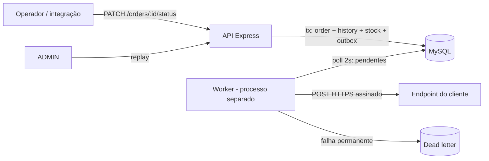

# RFC — Sistema de Webhooks de Notificação de Pedidos

| Campo | Valor |
| --- | --- |
| **RFC** | RFC-001 |
| **Autor** | Matheus Caldeira (redação a partir da reunião técnica conduzida por Larissa) |
| **Status** | Em revisão |
| **Data** | 2026-11-09 |
| **Revisores** | Larissa (Tech Lead), Marcos (Product Manager), Bruno (Eng. Pleno, Pedidos), Diego (Eng. Sênior, Plataforma), Sofia (Eng. de Segurança) |
| **Documentos relacionados** | [PRD](PRD.md) · [FDD](FDD.md) · [ADRs](adrs/README.md) · [Tracker](TRACKER.md) |

> Este RFC registra a proposta técnica fechada na reunião para revisão pelo time, como combinado em [09:50] Larissa ("marcar uma sessão pro Bruno e o Diego revisarem comigo antes da gente começar a codar"). O detalhamento de implementação fica no [FDD](FDD.md).

## 1. Resumo executivo (TL;DR)

Propomos notificar clientes B2B sobre mudanças de status de pedido por **webhooks de saída**. Cada mudança de status grava um evento numa **tabela de outbox no MySQL, na mesma transação** da mudança. Um **worker em processo separado** lê a outbox **a cada 2 segundos** e faz o POST HTTPS para os endpoints cadastrados, **assinado com HMAC-SHA256** por uma secret própria de cada endpoint. Falhas seguem **retry com backoff de 1m/5m/30m/2h/12h** e depois vão para uma **DLQ** com replay manual por ADMIN. A entrega é **at-least-once**, com `X-Event-Id` para deduplicação. Tudo reaproveita os padrões atuais do código, sem infraestrutura nova. Estimativa: **3 sprints**, incluindo revisão de segurança.

## 2. Contexto e problema

Três clientes B2B (Atlas Comercial, MaxDistribuição e Nova Cargo) pediram notificação em tempo real de mudanças de status ([09:00] Marcos). Hoje eles fazem polling em `GET /orders`, o que é lento e caro para eles; a Atlas sinalizou que pode migrar para um concorrente se não houver entrega até o fim do trimestre ([09:00] Marcos). Para os clientes, "tempo real" é **abaixo de 10 segundos** ([09:02] Marcos). O fluxo é só de saída ([09:02] Marcos).

O OMS não tem hoje nenhum mecanismo de evento, fila ou notificação externa. A mudança de status vive em uma única transação em `src/modules/orders/order.service.ts` (`changeStatus`), que atualiza o pedido, grava o histórico e mexe no estoque ([09:04] Bruno). Ela já é a operação mais pesada do sistema e não pode depender da disponibilidade de terceiros.

## 3. Proposta técnica

### 3.1 Visão geral

### 3.2 Componentes e responsabilidades

| Componente | Responsabilidade | Decisão |
| --- | --- | --- |
| **Outbox no MySQL** | Registrar o evento atomicamente com a mudança de status; falha na outbox ⇒ rollback | [ADR-001](adrs/ADR-001-outbox-transacional-no-mysql.md) |
| **Enfileiramento na transação** | Filtrar endpoints interessados e gravar o payload já renderizado (snapshot) | [ADR-007](adrs/ADR-007-evento-filtrado-e-renderizado-na-insercao.md) |
| **Worker** | Processo próprio (`npm run worker`), polling de 2s, instância única, ordem por criação | [ADR-002](adrs/ADR-002-worker-separado-em-polling.md) |
| **Retry e DLQ** | Backoff 1m/5m/30m/2h/12h; depois, tabela de dead letter e replay manual por ADMIN | [ADR-003](adrs/ADR-003-retry-com-backoff-exponencial-e-dlq.md) |
| **Segurança** | HMAC-SHA256 do corpo, secret por endpoint, rotação com 24h de convivência, só `https` | [ADR-004](adrs/ADR-004-assinatura-hmac-sha256-com-secret-por-endpoint.md) |
| **Semântica de entrega** | At-least-once; `X-Event-Id` estável para deduplicação no cliente | [ADR-005](adrs/ADR-005-entrega-at-least-once-com-x-event-id.md) |
| **Módulo `src/modules/webhooks`** | API de configuração, histórico de entregas e replay, nos padrões atuais | [ADR-006](adrs/ADR-006-reuso-dos-padroes-existentes-do-projeto.md) |

### 3.3 Superfície exposta (resumo)

- **API de configuração** (qualquer usuário autenticado, por ora): cadastrar, listar, editar e remover endpoints; rotacionar secret; consultar o histórico das últimas 100 entregas ([09:31] a [09:34] Marcos/Bruno; [09:37] Sofia).
- **Replay de DLQ** (somente ADMIN, auditado em log) ([09:36] Sofia).
- **Requisição ao cliente**: JSON enxuto `order.status_changed`, sem itens, com headers `X-Event-Id`, `X-Signature`, `X-Timestamp`, `X-Webhook-Id`; timeout de 10s; limite de 64KB ([09:42] a [09:44] Diego/Sofia; [09:24] Larissa).

Contratos, payloads, códigos de erro e fluxos estão no [FDD](FDD.md).

## 4. Alternativas consideradas

| ID | Alternativa | Por que foi descartada (trade-off) | Fonte |
| --- | --- | --- | --- |
| RFC-ALT-01 | **Disparo HTTP síncrono em `changeStatus`** | Menor latência e nenhuma tabela nova, mas um cliente lento seguraria a transação e travaria mudanças de status de outros pedidos; cliente fora do ar forçaria rollback do status ou perda do evento. | [09:04] Bruno; [09:06] Diego |
| RFC-ALT-02 | **Redis Streams / broker dedicado** | Modelo de fila nativo, mas exige subir e operar infraestrutura nova; Redis Cluster seria overengineering para um time pequeno, e o outbox no MySQL existente já resolve. | [09:07] Larissa; [09:07] Diego |
| RFC-ALT-03 | **Trigger de banco para acordar o worker** | Seria mais reativo, mas MySQL não tem LISTEN/NOTIFY; trigger não avisa processo externo e exigiria gambiarras. Polling de 2s já cumpre a meta de < 10s. | [09:09] Bruno; [09:09] Diego |
| RFC-ALT-04 | **Worker dentro do processo da API** | Um processo a menos, mas reinício/deploy da API derrubaria as entregas. | [09:11] Diego |
| RFC-ALT-05 | **Garantia exactly-once** | Poupa o cliente de deduplicar, mas exige coordenação dos dois lados e muito mais complexidade; at-least-once com id resolve a grande maioria dos casos. | [09:25] Diego |
| RFC-ALT-06 | **Secret global da plataforma** | Gestão trivial, mas um vazamento comprometeria todos os clientes. | [09:21] Sofia |

Alternativas de menor porte (3 tentativas ou retry infinito, DLQ como flag na outbox, renderizar o payload no envio, filtrar no envio) estão nos ADRs 003 e 007.

## 5. Questões em aberto

| ID | Questão | Situação na reunião | Fonte | Proposta deste RFC |
| --- | --- | --- | --- | --- |
| RFC-OQ-01 | **Rate limiting de saída** por cliente (ex.: 50 pedidos mudando em 1 min) | Fora do escopo; "observar e decidir depois" | [09:39] Larissa | Medir eventos/min por endpoint (FDD §10) e decidir com dados. |
| RFC-OQ-02 | **Aviso por email** quando o webhook do cliente falha repetidamente | Adiado para a próxima fase | [09:37] Larissa | Fora desta entrega; a DLQ e o histórico servem de base para medir. |
| RFC-OQ-03 | **Escalar para múltiplos workers** sem perder a ordem por pedido | "Problema do futuro" (particionar por `order_id` ou lock pessimista) | [09:13] Diego | Manter instância única; revisitar se o backlog crescer. |
| RFC-OQ-04 | **Arquivamento** de eventos entregues (~30 dias) | Fora do escopo desta feature | [09:08] Diego | Projeto separado; índices mitigam até lá. |
| RFC-OQ-05 | **Ordem sob retry**: um evento em backoff pode ser ultrapassado por um evento mais novo do mesmo pedido | Não discutido (a garantia de ordem foi dada assumindo sucesso) | [09:13] Larissa | Documentar como limitação; clientes não pediram ordem global ([09:14] Marcos). Revisores decidem se vale bloquear eventos posteriores do mesmo pedido. |
| RFC-OQ-06 | **`X-Timestamp` não é coberto pela assinatura** (HMAC só do corpo), enfraquecendo a detecção de replay | Não discutido | [09:44] Diego | Levar à revisão de segurança da Sofia. |
| RFC-OQ-07 | **Proteção da secret em repouso** (HMAC exige secret recuperável) | Não discutido | [09:46] Sofia | Levar à revisão de segurança; redigir secrets nos logs desde já. |
| RFC-OQ-08 | **"5 tentativas"**: 5 envios no total ou 1 envio + 5 re-tentativas? | Ambíguo (5 intervalos somando ~15h "entre primeira falha e última tentativa") | [09:17] Larissa | Adotar 1 + 5 (coerente com a soma) até confirmação. |
| RFC-OQ-09 | **`customer_id` no body ou no path** | "no body ou no path", não fechado | [09:32] Larissa | Body no cadastro e query string na listagem, como o módulo de pedidos já faz. |
| RFC-OQ-10 | **Endurecer permissões do CRUD** de configuração | "Por enquanto" qualquer role autenticada | [09:37] Sofia | Manter; revisitar após a primeira fase. |

## 6. Impacto e riscos

**Impacto no sistema existente**

- `changeStatus` ganha uma etapa a mais na transação (consulta de endpoints e inserção na outbox). Falha nessa etapa desfaz a mudança de status, por decisão explícita ([09:40] Bruno).
- Novo processo para operar (`npm run worker`) e três novas tabelas mais a de configuração; nenhuma dependência nova.
- Nenhuma mudança de contrato nos endpoints existentes.

**Riscos principais** (detalhes, probabilidade e mitigação no [PRD §10](PRD.md#10-riscos-e-mitigação) e no [FDD §14](FDD.md#14-riscos-e-mitigação))

| Risco | Mitigação proposta |
| --- | --- |
| Prazo: a Atlas quer a feature no fim de novembro e pode migrar ([09:45] Marcos) | Escopo enxuto (email, painel e rate limit fora); 3 sprints com revisão de segurança ([09:47] Larissa) |
| Worker único e sequencial: clientes lentos (até 10s cada) atrasam os demais | Timeout de 10s ([09:42] Diego); métrica de idade do evento mais antigo; concorrência como evolução |
| Clientes que não deduplicam recebem eventos repetidos | `X-Event-Id` + documentação destacada no portal ([09:26] Marcos) |
| Vazamento de secret pelo cliente ([09:22] Diego) | Secret por endpoint + rotação com 24h + redação nos logs |

## 7. Decisões relacionadas

- [ADR-001 — Outbox transacional no MySQL](adrs/ADR-001-outbox-transacional-no-mysql.md)
- [ADR-002 — Worker separado em polling de 2s](adrs/ADR-002-worker-separado-em-polling.md)
- [ADR-003 — Retry com backoff exponencial e DLQ](adrs/ADR-003-retry-com-backoff-exponencial-e-dlq.md)
- [ADR-004 — HMAC-SHA256 com secret por endpoint](adrs/ADR-004-assinatura-hmac-sha256-com-secret-por-endpoint.md)
- [ADR-005 — At-least-once com `X-Event-Id`](adrs/ADR-005-entrega-at-least-once-com-x-event-id.md)
- [ADR-006 — Reuso dos padrões existentes](adrs/ADR-006-reuso-dos-padroes-existentes-do-projeto.md)
- [ADR-007 — Evento filtrado e renderizado na inserção](adrs/ADR-007-evento-filtrado-e-renderizado-na-insercao.md)

## 8. Pedido aos revisores

- **Larissa / Diego / Bruno:** validar RFC-OQ-05, RFC-OQ-08 e RFC-OQ-09 antes do início da implementação.
- **Sofia:** RFC-OQ-06 e RFC-OQ-07 na revisão de segurança de 2 dias úteis ([09:46] Sofia).
- **Marcos:** confirmar com a Atlas o prazo e a documentação de deduplicação no portal ([09:47] Marcos, [09:26] Marcos).
