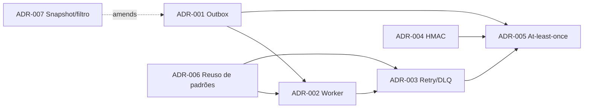

# Architectural Decision Records

Este diretório armazena os ADRs (Architectural Decision Records) do projeto,
no formato MADR adaptado para português, nomeados como
`ADR-NNN-titulo-em-kebab-case.md`.

Cada ADR tem: Status, Contexto e Problema, Direcionadores da Decisão,
Alternativas Consideradas, Decisão, Prós e Contras das Alternativas,
Consequências (positivas, negativas e trade-off explícito) e Referências.

## Índice — Sistema de Webhooks de Notificação de Pedidos

| ADR | Decisão | Status |
| --- | --- | --- |
| [ADR-001](ADR-001-outbox-transacional-no-mysql.md) | Outbox transacional no MySQL | Aceito |
| [ADR-002](ADR-002-worker-separado-em-polling.md) | Worker em processo separado, polling de 2s, instância única | Aceito |
| [ADR-003](ADR-003-retry-com-backoff-exponencial-e-dlq.md) | Retry 1m/5m/30m/2h/12h e DLQ em tabela separada | Aceito |
| [ADR-004](ADR-004-assinatura-hmac-sha256-com-secret-por-endpoint.md) | HMAC-SHA256, secret por endpoint, rotação com grace period de 24h | Aceito |
| [ADR-005](ADR-005-entrega-at-least-once-com-x-event-id.md) | At-least-once com `X-Event-Id` | Aceito |
| [ADR-006](ADR-006-reuso-dos-padroes-existentes-do-projeto.md) | Reuso dos padrões existentes do projeto | Aceito |
| [ADR-007](ADR-007-evento-filtrado-e-renderizado-na-insercao.md) | Evento filtrado e renderizado na inserção (snapshot) | Aceito |

## Relações

Decisões secundárias (formato do payload, timeout de 10s, headers, limite de
64KB, TLS obrigatório) ficaram no [FDD](../FDD.md), conforme a própria reunião
indicou ("não vejo como decisão arquitetural separada", [09:24] Larissa).
